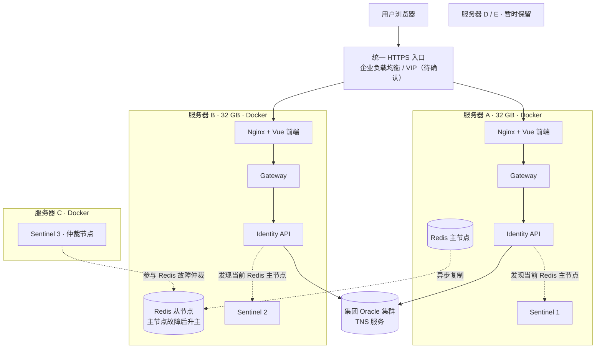

# MOM 一期部署架构草案

> 2026-10-27：当前执行方案为 176 前端独立 HTTPS 端口、177/178 各运行 Gateway 与 Identity Docker 容器，详见 [Docker 离线部署](docker-deployment.md)。Redis/Sentinel 继续使用宿主机已有服务。本文以下保留早期 Docker/VIP 讨论，不作为本次执行方案；实际三台内存约 15.1 GiB，不能按下文 32 GB 假设分配。

[文档导航](README.md) · [开发环境](development.md) · [登录与会话](authentication.md)

此图是目标部署方案，不表示当前仓库已经具备生产部署能力。集团提供 Oracle 集群与 TNS；本地五台服务器中先使用两台 32 GB 服务器承载应用与 Redis，第三台承载 Sentinel 仲裁，另外两台保留。

图中的主从是初始角色；切换后角色可能互换，不应假定 A 永远是主节点。Redis 连接线仅示意发现流程：两台 Identity 实例均须配置三个 Sentinel 地址与相同的服务名，从 Sentinel 查询当前主节点后直接连接主节点；三个 Sentinel 均监视两台 Redis。Redis A 故障时，B 和 C 上的两个 Sentinel 保持多数票，可将 B 提升为主节点。若 B 故障，A 继续提供 Redis 服务，但在 B 恢复前没有副本。

| 职责 | 部署方式 |
| --- | --- |
| 前端与网关 | A、B 部署相同版本镜像；统一入口对两台做健康检查并转发流量。 |
| Identity 等应用服务 | A、B 部署相同版本；共享 Oracle、Redis、JWT 密钥和环境配置，容器本身不保存会话。 |
| Redis | A 主、B 从，均使用持久化卷；密码及网络访问受控。主从复制为异步，切换时可能短暂重连或丢失最近写入。 |
| Sentinel | A、B、C 各一个进程，部署在三个独立故障域；仅在 A、B 上运行两个 Sentinel 不能满足单机故障后的可靠仲裁。 |
| Oracle | 使用集团集群提供的 TNS/服务名；应用账号、密码及可能需要的 Wallet 由部署配置安全注入，不放进镜像。 |
| 服务器 D / E | 一期暂不投入，留作扩容、监控或预发环境。 |

## 部署前确认

1. 确认企业负载均衡或 VIP、HTTPS 证书、健康检查方式，以及 A、B 是否处于不同物理宿主机。没有统一入口切换时，两套应用不构成完整对外高可用。
2. 完成生产镜像与 Compose 配置；当前仓库的 Redis Compose 仅供开发使用，应用 Dockerfile 与网关目标、反向代理及健康检查仍需部署验收。
3. 验证 Identity 使用的 Redis 客户端按 Sentinel 服务名发现主节点并在切换后重连；配置 AOF、备份、监控和故障演练。Redis 会话与权限缓存不能承诺零数据丢失。
4. 确认两台应用服务器到集团 Oracle 集群、三台 Sentinel 之间及应用到 Redis 节点的网络连通，按实际地址与端口收紧防火墙。
5. 生产密钥、TNS/Wallet 和数据库迁移独立于镜像管理；两台实例使用相同 JWT 签名密钥，先迁移数据库再发布应用。
