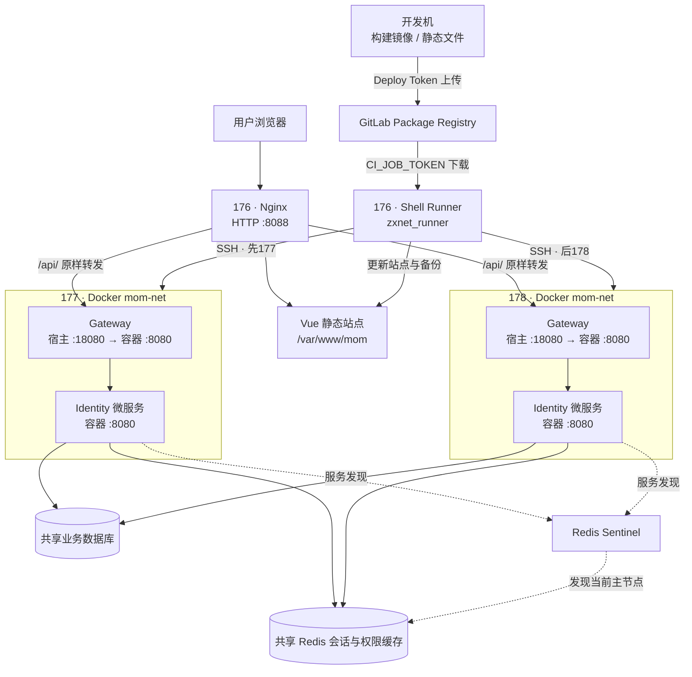

# MOM 当前部署拓扑

[文档导航](README.md) · [Runner 发布](deployment.md) · [登录与会话](authentication.md)

截至 2026-10-29，当前环境为 176 静态前端与统一入口、177/178 双后端节点。服务器间内网互通，服务器不访问外网；镜像和前端包由开发机构建，GitLab Runner 下载成品发布。

## 节点与固定参数

| 位置 | 当前职责 / 参数 |
| --- | --- |
| `10.32.15.176` | Nginx 入口、前端站点、GitLab Shell Runner；入口 `http://10.32.15.176:8088/` |
| `10.32.15.177`、`10.32.15.178` | 各运行 `mom-gateway`、`mom-identity`，版本和运行配置保持一致 |
| 每台后端 `mom-net` | 独立 Docker bridge，网段 `172.30.176.0/24`；两台可以使用相同容器 IP |
| `mom-gateway` | 固定 IP `172.30.176.10`，容器 `8080` 映射到宿主机 `0.0.0.0:18080` |
| `mom-identity` | 固定 IP `172.30.176.11:8080`，不发布宿主机端口 |
| 前端备份 | `/var/www/mom-backups/`，由 Runner 账号写入 |
| 数据库与 Redis | 沿用已部署基础设施，连接信息通过 GitLab Variables 注入；不随应用包重建 |

Gateway 按 `/api/identity` 前缀转发到同机 Identity。Gateway 信任直接上游 Nginx，Identity 信任同机 Gateway；生产请求的协议和客户端 IP 由这条代理链传递。浏览器使用同源 `/api`，不直连后端节点。

两台 Identity 共享数据库、Redis/Sentinel 服务名、生产缓存前缀及 JWT Key/Issuer/Audience；开发与生产使用不同缓存前缀和环境配置。Redis/Sentinel 的实际节点和主从角色以基础设施配置为准，不假定某台永远为主节点。

## 当前发布与可用性边界

发布逻辑集中在 [mom_img/.gitlab-ci.yml](https://bu17gitlab.luxshare.com.cn/awe/mom_img/-/blob/main/.gitlab-ci.yml)。后端先检查两台，再依次更新；前端独立更新静态文件。数据库结构由 DBA 在应用发布前执行 SQL，不由容器启动时迁移。

当前仍是单个 Nginx/前端入口；双后端节点不代表整套入口已具备高可用。流水线不执行摘流、连接排空或入口切换，发布期间可能短暂请求失败。Redis 故障切换、数据库可用性和完整业务恢复需要单独验证。

当前流水线面向已准备好的环境，不安装基础设施、不创建 Docker 网络或空库、不调整 Nginx 和防火墙。新增服务时需同步构建包、网关路由、流水线和验证步骤，不能仅添加镜像就视为已接入部署。
