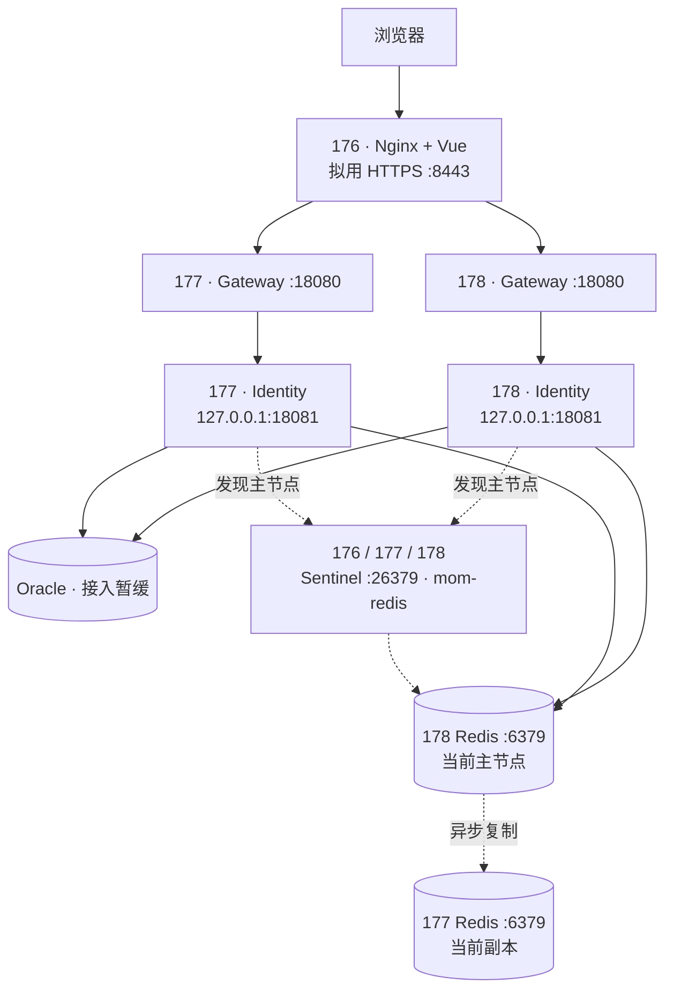

# MOM 原生部署

[文档导航](README.md) · [登录与会话](authentication.md) · [数据库](database.md)

> 当前执行方案已改为 [Docker 离线部署](docker-deployment.md)（2026-10-27）。本文保留原生 systemd 方案供参考，本次按 Docker 手册操作，服务器无需另装 .NET 10 Runtime。不要混用两套服务启动和环境文件格式。

2026-10-26 确定：176 的现有 Nginx 加独立端口，177、178 各运行 Gateway 和 Identity，以 systemd 管理 .NET 程序。三台内存约为 15.1 GiB。当前按预发布环境准备，数据库接入暂缓，生产库尚未申请；配置模板不代表已部署。



Redis 角色为此前演练后的状态，之后可能互换；应用配置全部 Sentinel 地址，不固定连接 178。176 只有 Sentinel，没有 Redis 数据节点。此次新应用发布不需要重启 Redis。

## 主机与目录

| 主机 | 新 MOM 职责 | 现有服务约束 |
| --- | --- | --- |
| 176 | Vue、HTTPS、反向代理 | 保留 Nginx 80 的 `/zx/`、`/zxmobile/`、`/zxadmin/`，保留 Runner、采集与监控。 |
| 177 | Gateway + Identity | 保留现有 7278 等应用、采集与监控；Redis 副本和 Sentinel 已运行。 |
| 178 | Gateway + Identity | 保留现有 zxadmin 与监控；Redis 主节点和 Sentinel 已运行。 |

8443、18080、18081 是拟用端口，须实查未占用。后端用独立 `mom` 系统账号，程序在 `/opt/mom/releases/<版本>/{identity,gateway}`，`/opt/mom/current` 指向当前版本。前端放 `/var/www/mom/releases/<版本>`，`/var/www/mom/current` 指向构建产物根目录。私有配置置于 `/etc/mom/`，不放进发布包。

## 配置模板

[deploy/native](../deploy/native) 提供以下文件，尚未安装到服务器：

- `mom.nginx.conf`：176 的独立站点 `/etc/nginx/conf.d/mom.conf`。证书需包含 IP `10.32.15.176` 的 SAN，并受客户端信任，拟用入口 `https://10.32.15.176:8443`。新站点验收后执行 `nginx -t` 和平滑 reload。
- `mom-identity.service`、`mom-gateway.service`：两台后端相同版本。执行路径假设为 `/usr/bin/dotnet`，需 .NET 10 ASP.NET Core Runtime；只管理新 `mom-*` 服务。
- `identity.env.example`：复制到 `/etc/mom/identity.env`，由服务器管理者填写 Oracle、Redis 和 JWT 配置。值故意留空，配置及数据库未就绪前不启动服务。首个管理员由运维人员单独执行本机 SQL 创建，不通过环境变量配置。
- `gateway.env.example`：复制到 `/etc/mom/gateway.env`，178 将监听 IP 改为自身地址。Gateway 只信任 176，Identity 只信任回环代理。
- `journald@mom.conf`：安装为 `/etc/systemd/journald@mom.conf`。服务用 `LogNamespace=mom` 收集到独立 journal，目标上限 512 MB、最长 14 天，不修改旧业务全局日志策略；容量与时间共同约束，不能保证保满 14 天。需核实服务器 systemd 支持命名空间。

`/etc/mom` 由 root 持有，目录 0700，环境文件 0600，systemd 读取后传给进程。真实凭据不进 Git。示例采用 systemd EnvironmentFile 格式，不是 shell 脚本，不要 `source` 执行；值含空格时按该格式加引号。

两台 Identity 的 schema、JWT 密钥、Issuer/Audience、Redis 服务名和前缀必须一致。预发布前缀 `mom:staging:identity:auth:`，与本机开发的 Redis 会话隔离。刷新 Cookie 仍为代码中的 `zx_identity_refresh`、路径 `/api`；Cookie 不按端口隔离，同一 IP 上不能靠换端口隔离两套使用相同 Cookie 的 MOM。运行环境用 `Production` 启用安全约束，这不表示已接生产库。正式上线时另备生产 schema、密钥和前缀。

Redis 连接形状如下，密码只在服务器私有配置填写：

```text
10.32.15.176:26379,10.32.15.177:26379,10.32.15.178:26379,serviceName=mom-redis,user=default,password=<私有密码>,connectTimeout=3000,asyncTimeout=3000
```

## 请求链

浏览器访问 176 的同源 `/api`。现有前端 `.env.production` 已使用 `/api`，路由基址 `/`，独立端口部署无需修改 API 路径。Nginx 保留 `/api/identity/...`，Gateway 移除 `/api/identity` 后转发 Identity。

Nginx 覆盖客户端 IP 和协议头，两个 .NET 服务仅接受各自可信直接上游的一跳转发；YARP 为下一跳重新生成头。HTTPS 在 Nginx 终止，内部 HTTP 限可信内网。Identity 仅绑定回环；Gateway 18080 的网络来源应限制为 176，可信代理配置不能代替网络访问控制。Redis/Sentinel 也需按应用及运维来源限制。现有 firewalld 未启用，准备阶段不直接开启，以免影响旧业务。

## 发布顺序

1. 只读核对端口、177/178 的 .NET Runtime、176 的证书及 Nginx 配置，记录旧站点状态。服务器不重启。
2. 准备独立账号、目录、MOM 日志命名空间和服务配置。数据库暂不接时停在这里，不启用 Identity。
3. 恢复数据库接入时，核对版本与独立 schema。数据库统一使用 Oracle 19c 模型及 `NUMBER(1)` 布尔字段。由一个发布任务执行 [Oracle 迁移](database.md)，应用启动不会自动迁移。
4. 发布两个后端项目。前端从单独仓库构建，遵守该仓库的检查规范。只传构建产物，不传 User Secrets 或开发证书。
5. 先启动并验证 177，再验证 178；确认会话互通后安装 176 的前端和新站点，`nginx -t` 成功后仅 reload。
6. 浏览器验收登录、刷新、权限、路由和两实例共享会话。应用单节点故障和 Redis 故障切换分别演练；此前 Redis 演练不代表应用切换已验收。

仓库根目录的后端发布命令：

```bash
dotnet publish Services/Identity/ZX.Platform.Identity.Api/ZX.Platform.Identity.Api.csproj -c Release -o artifacts/identity
dotnet publish ZX.Platform.Gateway/ZX.Platform.Gateway.csproj -c Release -o artifacts/gateway
```

服务器排错命令：

```bash
systemctl status mom-identity mom-gateway --no-pager
sudo journalctl --namespace=mom -u mom-identity -u mom-gateway -n 100 --no-pager
```

应用日志只写独立 journal。176 新日志须确认已被 Nginx 的 logrotate 规则覆盖（通常是 `/var/log/nginx/*log`），避免无限增长或重复轮转。

更新时逐台摘流，停止该台 MOM 服务，切换版本目录，启动验收后恢复流量；不要在服务仍运行时切换其文件。后端保留当前版和上一个验收版；前端需兼顾浏览器已加载资源再清理旧版本。回退程序前确认数据库迁移向后兼容，切换目录不会撤销数据库变化。

## 当前边界

176 是唯一网页入口，双后端不能消除入口单点。Nginx 模板只做被动故障检测，没有业务就绪检查，默认不重放已经发出的非幂等请求。Redis 异步复制和 AOF everysec 不保证零丢失。两个应用实例限流按进程计数，并非集群共享额度。

尚未实查新端口、安装 Runtime/服务、配置证书、接数据库、构建前端或发布新 MOM。模板和本机检查不能替代服务器验收。

2026-10-26 本机检查：两个项目编译通过，真实 HTTP 管道验证可信代理的 HTTPS/IP 转发、非可信转发头拒绝及普通 HTTP 重定向。可单独执行 `dotnet run --project Tests/ZX.Platform.Identity.AuthChecks -- --forwarded-headers-only`，该子集不访问 Redis 或 Oracle；本次未重跑完整认证检查。Nginx 和 systemd 模板仍需在目标 Linux 上分别检查。原三台 SSH 会话已自动退出，服务器只读核对尚待恢复连接。
